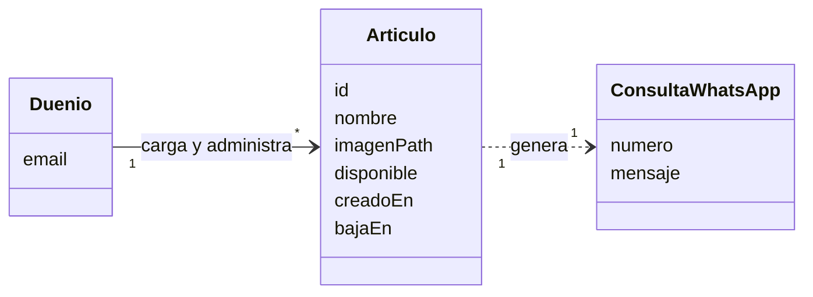

# Modelo de dominio — Catálogo Noventa Camisetas

> Versión preliminar (15/11/2026). Basada en el pedido del cliente.
> Los puntos marcados con ⚠️ están pendientes de confirmación con el cliente.

## 1. Diagrama de clases

## 2. Entidades

### Articulo
Un producto que el dueño tiene para vender (camiseta, short, botines, etc.).

| Atributo | Tipo | Regla |
|---|---|---|
| `id` | uuid | Generado por la base. |
| `nombre` | texto | Obligatorio, entre 3 y 80 caracteres, sin espacios al inicio ni al final. |
| `imagen_path` | texto | Ruta del archivo en el bucket `articulos` de Supabase Storage. Obligatoria. |
| `disponible` | booleano | `true` al crearlo. El dueño lo pasa a `false` cuando se queda sin stock. |
| `creado_en` | fecha y hora | Generado por la base. |
| `baja_en` | fecha y hora o nulo | Baja lógica: si tiene fecha, el artículo ya no existe para nadie. |

⚠️ Pendiente con el cliente: ¿mostrar precio?, ¿talles?, ¿categorías (selecciones, clubes, retro)?

### Dueño
El único usuario con login (Supabase Auth, email y contraseña). No se registra desde la web: se crea a
mano en el panel de Supabase.

### ConsultaWhatsApp (no se guarda)
Es el enlace que se arma al presionar **Consultar**: `https://wa.me/<numero>?text=<mensaje>`.
El número sale de la variable `VITE_WHATSAPP_NUMERO`.

## 3. Reglas de negocio

| ID | Regla | Dónde |
|---|---|---|
| R1 | El catálogo público muestra los artículos con `baja_en` nulo: primero los disponibles y después los sin stock, cada grupo del más nuevo al más viejo. Los sin stock llevan la etiqueta "Sin stock". | `articulos.rules.js` + política RLS |
| R2 | El nombre es obligatorio, se recorta y debe tener entre 3 y 80 caracteres. | `articulos.rules.js` |
| R3 | La imagen original debe ser JPG, PNG o WEBP y pesar como máximo 10 MB. | `articulos.rules.js` |
| R7 | Antes de subirla, la foto se comprime a WEBP con el lado mayor en 1200 px como máximo, manteniendo la proporción y sin agrandar fotos chicas. Así entran miles de fotos en el 1 GB gratuito. | `articulos.rules.js` (medidas) + canvas en el navegador |
| R4 | El número de WhatsApp se normaliza a solo dígitos con código de país (ej. `5493511234567`). | `whatsapp.rules.js` |
| R5 | El mensaje de consulta va codificado en la URL. Artículo disponible: `Hola! Quiero consultar por: <nombre del artículo>`. Artículo sin stock: `Hola! ¿Te vuelve a entrar <nombre del artículo>?`. | `whatsapp.rules.js` |
| R6 | Solo el dueño puede crear, editar o dar de baja artículos y subir imágenes: las políticas comparan `auth.uid()` con su id. El registro de usuarios está desactivado. El público y el dueño leen los artículos no dados de baja. | Políticas RLS + configuración de Auth |
